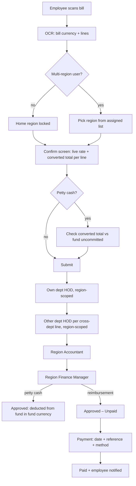

# Expense flow — gap analysis and implementation plan

Date: 2026-10-30. Scope: currency conversion, region-scoped approvers, reimbursement payment step,
petty-cash top-up chain, and cross-department routing for multi-item bills.

Every "today" statement below was checked against the code at the file/function named, not assumed.
Note: the status table in [`PETTY_CASH_PHASED_PLAN.md`](PETTY_CASH_PHASED_PLAN.md) was updated on 2026-11-04 to match this plan.

**Status summary (2026-11-04):** A ✅, B ✅, C ✅, E ✅ (without the stage-plan table). D is partly done. Every step now notifies (`fund_service._notify_topup`):
- a request notifies the company's Accountants and Admin;
- a verify notifies the FMs;
- a return or a decision notifies the HOD.

There is no Admin review step (`admin_reviewed`), which means Q1 is answered in practice as "notify only". F is mostly open.
Since then, `GET /api/approvals/{id}/funds` and `GET /api/funds/department-funds` let the HOD and FM see a bill's paying pots and a company's department pots. They are backend only for now; see [`CHANGELOG.md`](CHANGELOG.md).

---

## 1. Target flow (what the business wants)

### 1.1 Rules

| # | Rule |
|---|---|
| R1 | Employee scans a bill; the bill keeps its **own currency** (what is printed on it). |
| R2 | The bill is converted into the **base currency of the selected region** (company). Single-region user → their home region, preselected and locked. Multi-region user → region dropdown (only regions Admin assigned). |
| R3 | The converted amount is shown **on the confirm screen itself**, before submit (rate, rate date, converted total, and per line for multi-item bills). |
| R4 | Petty cash is **reserved and deducted in the converted (fund) currency**. Top-ups are in the fund currency too. |
| R5 | **HOD is per department, the same across all companies.** By default an HOD handles bills of their own region only; Admin can give selected HODs **extra regions** so they also handle those regions' bills. |
| R6 | **Accountant and Finance Manager are per region.** A KSA bill goes to KSA Accounts / KSA FM, never to UAE ones. |
| R7 | Reimbursement: after FM approval the claim shows **"Approved – Unpaid"**. A **Payment** step lets Finance mark it **Paid** with payment date, reference (and method). Employee gets a **Paid** notification. Stored in `payment_records` (Spec 5.5). |
| R8 | Petty-cash top-up request is raised by the HOD and **goes to Admin as well** (see open question Q1), then Accounts verify → FM approve + payment. |
| R9 | Multi-item bill: if a Sales employee tags some lines with an IT-owned category, **those lines also need IT HOD approval** — not only when the main category is IT. |

### 1.2 Target sequence

---

## 2. Current flow vs target: gaps

### 2.1 Currency conversion (R1–R4)

How it works today:
- Bill currency is chosen on the confirm screen (`_BillCurrencyFields`, `confirm_claim_screen.dart`), never silently defaulted.
- The backend stamps `exchange_rate` at submit using **today's** rate from a public CDN
  (`exchange_rate_service.lookup_rate`, called via `_stamp_exchange_rate` in `transaction_service.py`).
  Any client-sent rate is ignored.
- Fund math converts on the fly: `fund_service._tx_amount` = `total_amount × exchange_rate` when the bill currency differs from the fund currency.
- Detail and queue screens show the converted amount after submit (`claim_ui_helpers.dart`, `approval_queue_screen.dart`).

| Gap | Where | Impact |
|---|---|---|
| G1. **Converted amount is not shown on the confirm screen.** `ApiClient.lookupExchangeRate` and `GET /api/claims/exchange-rate` exist, but no screen calls them. | `confirm_claim_screen.dart`, `api_client.dart:196` | Employee submits blind; R3 not met. |
| G2. **Client petty-cash check compares the wrong currency.** `_pettyCashBlocksSubmit` compares `_claimAmount` (bill currency) with `pot.uncommitted` (fund currency). A 1,000 SAR bill on an AED fund is compared as "1,000 vs AED balance". The server check (`_require_petty_cash_limit`) converts correctly, so the two can disagree. | `confirm_claim_screen.dart:163-196` | Wrong block or false "OK" on screen, then a server error. |
| G3. **Rate is re-stamped on every edit and resubmit.** `update_draft` and `resubmit_after_dispute` both call `_stamp_exchange_rate`, so a disputed bill gets a new rate days later. Its converted amount (and the fund reservation) silently changes. | `transaction_service.update_draft`, `approval_service.resubmit_after_dispute` | Converted figure isn't stable; audit can't explain differences. |
| G4. **Rate date, source and converted totals are not stored.** Only `exchangeRate` is persisted. `as_of` (the actual date of the rate used — can be up to 7 days back) is thrown away. | `ErpExpenseTransaction` | No audit trail for FX; every report recomputes. |
| G5. **Three different "base currency per region" maps:** `fund_service._BASE_CURRENCY`, `tax_rules.yaml default_currency` (used by `_resolved_exchange_rate`), and Flutter `baseCurrencyForRegion`. | 3 files | Adding a region means editing 3 places; drift risk. |
| G6. Notifications/emails show `txn.currency txn.amount` (bill currency, **excluding VAT**). | `approval_service.advance`, `_notify_finance_on_submit` | Approvers see a different number than the screen total. |

### 2.2 Region and approvers (R2, R5, R6)

How it works today:
- Home region comes from ERP (`resolve_default_region_code`) and is carried in the JWT.
- Multi-region users are mapped in `ErpExpenseMultiRegionUserRegion` (Admin UI: `set_user_regions`).
- The confirm screen shows a region dropdown filtered to `allowedRegions`.

| Gap | Where | Impact |
|---|---|---|
| G7. **Accountant and FM are global.** `resolve_stage_approvers` for `accountant` / `finance_manager` returns every active user with that role, in all regions. | `approval_service.resolve_stage_approvers` | KSA bills land in UAE accountants' queues and vice versa. R6 not met. |
| G8. **HOD is not region-scoped.** `_hods_for_department` returns all HODs of the department, whatever the bill's region. There is no "this HOD also covers KSA" switch. | `approval_service._hods_for_department` | R5 not met: either everyone sees everything, or nothing is configurable. |
| G9. The `ErpExpenseMultiRegionUserRegion` mapping drives **login/bill-capture** only. Approval routing never reads it. | `auth/security.allowed_regions_for` | Admin's "multi-region" switch doesn't affect what an HOD approves. |
| G10. Single-region users can still change the Region dropdown when `allowedRegions` is empty (falls back to all regions). | `confirm_claim_screen.dart:336-345` | A single-region employee can file a bill under another company. |
| G11. Home region is looked up from ERP at login only and not stored locally, so routing can't use it cheaply. Each extra ERP query costs seconds on this DB (see [`APPROVAL_WORKFLOW_FINDINGS.md`](APPROVAL_WORKFLOW_FINDINGS.md) §3). | `ErpAuthExpenseUsers` | Region scoping would be slow unless cached. |

### 2.3 Reimbursement payment step (R7)

How it works today: FM's `finance_manager` queue also lists `status='approved'` reimbursements
(`list_queue`). The detail screen shows **Mark as paid** with a free-text remarks box.
`transaction_service.mark_paid` sets `status='paid'`, `paidOn=now` and sends a `paid` notification and email.

| Gap | Where | Impact |
|---|---|---|
| G12. **No `payment_records` table.** Method, reference and payment date are not stored as data — only free-text `remarks` (which also **overwrites** the claim's own remarks). | `transaction_service.mark_paid` | Spec 5.5 not met; no reconciliation. |
| G13. **No "Approved – Unpaid" label.** `StatusChip` shows `APPROVED` for both petty cash (settled) and reimbursement (still owed). | `status_chip.dart` | Employee can't tell if money is coming. |
| G14. Payment is buried inside the approval queue (mixed with pending approvals). There's no separate "Payments" list and no region filter. | `list_queue`, `approval_detail_screen.dart:319` | Finance can't work a payment batch. |
| G15. `paidOn` is server time, not the actual bank payment date. | `mark_paid` | Wrong date on reports. |

### 2.4 Petty-cash top-up (R4, R8)

How it works today: an HOD requests a top-up against approved petty-cash bills
(`fund_service.request_topup`). Then `submitted → verified` (Accountant or Admin) → `approved/rejected`
(FM or Admin, with payment method, reference and date). Bill amounts are frozen in the fund currency
(`ErpExpenseFundTopupBill.amount`).

| Gap | Where | Impact |
|---|---|---|
| G16. **No notification when a top-up is requested or verified.** Only the final decision notifies the HOD. Admin and Accounts must poll the Top-ups screen. | `fund_service.request_topup`, `verify_topup` | R8 "send to Admin" not met; requests sit unnoticed. |
| G17. Admin is not a defined step. Admin *can* verify or decide (shortcut), but isn't asked to. | `fund_service.decide_topup` | Unclear ownership. |
| G18. Verify and decide are not region-scoped: any accountant or FM can act on any region's top-up. | `verify_topup`, `decide_topup` | Same as G7. |
| G19. A multi-region HOD's `list_mine` returns department funds in **all** regions, not just the ones assigned to them. | `fund_service.list_mine` | HOD can raise top-ups for companies they don't cover. |

### 2.5 Cross-department routing for multi-item bills (R9)

How it works today: `resolve_stage_sequence` inserts **one** `department_hod` stage using **only the
claim-level `category_id`**. For multi-item bills the app sets that category to the main line's category
(`_categoryId = _mainLineCategory`, `confirm_claim_screen.dart:575`). Line items store their own
`category_id` (`ErpExpenseLineItem`), but routing never reads it.

| Gap | Impact |
|---|---|
| G20. A Sales bill whose main line is Stationery, with one IT line (a mouse), never reaches the IT HOD. | R9 not met — the main bug the business raised. |
| G21. If the main line *is* IT, the **whole** bill goes to the IT HOD, including non-IT lines. | IT HOD approves things that aren't theirs. |
| G22. Only one `department_hod` slot exists. `current_stage` is a plain string, so a bill touching IT **and** Admin/Facilities can't have two department stages. | Can't model 2+ owning departments. |
| G23. Stage labels assume one cross-department HOD (`resolve_stage_labels` → "IT HOD"). | Tracker wrong for 2+ departments. |

### 2.6 Efficiency gaps found along the way

| Gap | Where |
|---|---|
| G24. `transaction_to_dict` re-runs `resolve_stage_sequence` (with HOD lookups) for every row in every list, right after `list_queue` already resolved approvers. | `transaction_service.transaction_to_dict` |
| G25. `_apply_delegation` runs one query per approver per transaction. | `approval_service._apply_delegation` |
| G26. FM's approved-unpaid list loads **every** approved reimbursement in the system, unpaged. | `list_queue` |
| G27. `fund_to_dict` re-queries department users and all individual funds for every fund card (`_fund_bills`), and `topup_to_dict` reloads the fund again. | `fund_service` |
| G28. SLA escalation (`sla_service.check_overdue_stages`) is still never called; bulk-approve has no UI. | known, from earlier plan |

---

## 3. Plan

Six phases, ordered by business impact and dependency. Each phase ships backend + Flutter + tests and is demoable on its own.

### Phase A — Currency conversion, correct and visible (G1–G6)

**Schema** (`ErpExpenseRegionConfig`, `ErpExpenseTransaction`; one ALTER script in `backend/scripts/`):
- `ErpExpenseRegionConfig.baseCurrency NVARCHAR(8)` — single source of truth (DUBAI/UAE=AED, KSA=SAR, OMAN=OMR). Backfill from the current map. Delete `_BASE_CURRENCY`, stop using `tax_rules.yaml default_currency` for FX (keep it for the OCR fallback only), and have Flutter read `baseCurrency` from `/api/regions`.
- `ErpExpenseTransaction`: `baseCurrency`, `exchangeRateDate`, `exchangeRateSource`, `amountBase`, `vatAmountBase`, `totalAmountBase`.

**Backend**
- `_stamp_exchange_rate` fills all of the above in one place. Call it on the **first** submit only. On resubmit after a dispute, keep the locked rate unless the bill currency or region changed. Draft edits only *preview* (don't persist a locked rate).
- `fund_service._tx_amount` reads `totalAmountBase` (fallback: today's on-the-fly calculation for old rows).
- `GET /api/claims/exchange-rate` stays as the preview endpoint. Add `region_code` as an alternative to `to`, so the client doesn't need to know the base currency.
- Notifications and emails show `BILL 1,000.00 SAR (≈ AED 978.20)` using `total_amount`, not `amount`.
- Backfill script: compute `*_Base` for existing submitted rows from their stored `exchangeRate`.

**Flutter — confirm screen**
- When bill currency ≠ region base currency: call `lookupExchangeRate` (debounced, on change of currency, region, total or lines). Show a card under the currency field:
  `Converted: AED 978.20 · 1 SAR = 0.9782 AED · rate of 30 Oct 2026`. In multi-item mode, show the converted amount per line as well.
- Fix `_pettyCashBlocksSubmit` to compare the **converted** total with `pot.uncommitted`. If the rate can't be loaded, don't block on the client; the server check decides.
- Rate fetch failure → inline warning plus "Submit will use the rate at submission time". Submission still fails cleanly if the server can't get a rate (current behaviour).
- After submit, show the server-stamped figures (authoritative).
- Region dropdown: if the user has 0–1 allowed regions, show the home region read-only (fixes G10).

**Tests:** extend `tests/test_funds_and_regions.py` — SAR bill on AED fund reserves the converted amount; rate is locked across dispute → resubmit; region switch on a draft re-quotes.

**Status (2026-10-30) — implemented (Q4 default: rate of the first submit, locked):**
- Columns added by `scripts/add_currency_region_payment_schema.py` (idempotent ALTER + backfill, run from the startup seed). `services/currency.py` is the single base-currency source; `_BASE_CURRENCY` is gone. `/api/regions` returns `base_currency`, which Admin can change via `PUT /api/admin/config/regions/{id}`.
- `transaction_service._stamp_exchange_rate` stamps rate, rate date, source and the three base amounts. Drafts re-quote on save. A disputed bill keeps its rate unless its currency or company changes; resubmit reuses it. Rates sent by the client are ignored.
- `fund_service._tx_amount` uses `totalAmountBase`. Notifications and emails show `SAR 1,000.00 (≈ AED 978.20)`, and the emails add a "Total in AED" row and the rate.
- `GET /api/claims/exchange-rate?from=SAR&region_code=UAE` previews the rate.
- Confirm screen: a "Converted: …" card, an "In AED" row in the cross-check dialog, a petty-cash check on the converted amount (no client block while the rate is unknown), and a locked company field for single-company users. Claim detail shows each line's converted amount.
- Tests: `tests/test_currency_region_payment.py`.

### Phase B — Region-scoped approvers (G7–G11, G18, G19)

**Schema**
- `ErpAuthExpenseUsers.homeRegionId` — written at login from `resolve_default_region_code` (no ERP query at routing time).
- New `ErpExpenseRegionApprover(userId, regionId, roleCode IN ('accountant','finance_manager'), isActive)` — who is Accounts and FM for each company. One person can cover several regions with several rows.
- HOD region coverage = `homeRegionId` ∪ active rows in the existing `ErpExpenseMultiRegionUserRegion`. No new table — the "multi-region option selected by Admin" is that mapping, now also used for approvals.

**Backend (`approval_service`)**
- `_hods_for_department(db, dept_id, region_id)`: department HODs whose region coverage includes the bill's region.
- `accountant` / `finance_manager` stages: users in `ErpExpenseRegionApprover` for (bill region, role), then delegation as today.
- **No-approver fallback** (so a bill never gets stuck): if a stage resolves to nobody, route to Admin, notify Admin with "No KSA Accountant configured", and log it in history.
- Same scoping for `verify_topup` / `decide_topup` (by `fund.region_id`) and `fund_service.list_mine` for HODs (only regions they cover).
- Load an approver's region set **once per request** and pass it down (keeps queue loads fast — see G11).

**Flutter / Admin**
- Admin → People: per user, "Regions this person covers" (already exists for multi-region) plus, for accountant/FM, "Approver for: [UAE] [KSA] …".
- Admin → Regions: per region, list its Accountants and FMs, with a warning badge when a role is empty.

**Tests:** KSA bill only visible to KSA accountant; Sales HOD with UAE only doesn't see a KSA Sales bill; after Admin adds KSA to that HOD, they do; empty region role → Admin fallback.

**Status (2026-10-30) — implemented, without `ErpExpenseRegionApprover`:**
- There is one coverage rule for every role (`services/region_scope.py`). A person covers their `homeRegionId`, saved at login, refresh, switch-region and `/me`, plus the companies Admin ticked in `ErpExpenseMultiRegionUserRegion`. A separate approver table wasn't needed, because an Accountant or FM is the Accounts or FM of the companies they cover.
- Anyone with no home company and no ticked companies counts as unrestricted, so old accounts keep working until they next sign in.
- Coverage applies to:
  - HOD and department-HOD stages, and the Accountant and FM stages;
  - top-up list, verify and decide;
  - the funds an HOD sees;
  - the companies an employee may file a bill under.
- If a step has nobody (Q6), it goes to Admin, with a warning in the log.
- Admin → company → **Approvers** tab (`GET /api/admin/config/regions/{id}/approvers`) lists the HODs, Accountants and FMs for that company, and warns when a role is empty. The People screen explains that ticked companies also decide approvals.
- Not done: caching each approver's company set per request (G11). Coverage is currently a SQL `EXISTS` per lookup.

### Phase C — Reimbursement payment step (G12–G15)

**Schema:** `ErpExpensePaymentRecord` (Spec 5.5 `payment_records`):
`paymentId, transactionId (unique), amount, currency (= base currency), paymentMethod (bank_transfer | cash | payroll | cheque), paymentReference, paymentDate, paidBy, remarks` + audit columns.

**Status model:** keep DB `status='approved'` (fund math, filters and tests key off it). Add a derived API field `payment_status`: `not_applicable` (petty cash) | `unpaid` | `paid`. Display:
- reimbursement + approved → **Approved – Unpaid**
- paid → **Paid** (with date and reference)
- petty cash + approved → **Approved – Settled from fund**

**Backend**
- Replace `POST /api/admin/claims/{id}/mark-paid` with `POST /api/payments` taking `{transaction_id, payment_method, payment_reference, payment_date, remarks}`. Reference and date are required. Region FM (Phase B) or Admin only. Stop overwriting `txn.remarks`.
  Keep the old route as a thin wrapper for one release (web-admin `ClaimDetailPage.tsx` uses it).
- Writes the payment record + `status='paid'` + `paidOn = payment_date` + history row `paid`, then sends the existing `paid` notification and email (now with reference and date).
- `GET /api/payments/pending?region=` — paged list of approved-unpaid reimbursements (moves this out of `list_queue`, fixes G26). Optional batch: `POST /api/payments/batch` with one reference for many claims.

**Flutter**
- `StatusChip` takes `payment_status` and shows the labels above.
- New **Payments** tab for FM and Admin: Unpaid list (region filter, totals in base currency), then a payment sheet with method, reference, date picker (defaults to today) and remarks.
- Employee claim detail shows the payment block (method, reference, date).

**Tests:** can't pay petty cash; can't pay a non-approved claim; reference required; employee gets one `paid` notification; double payment rejected (unique `transactionId`).

**Status (2026-10-30) — implemented (Q5: the company's FM + Admin; Q7: all four methods):**
- `services/payment_service.py` and `api/routes_payments.py` provide:
  - `GET /api/payments?status=unpaid|paid&region_code=`, paged, with totals per base currency;
  - `POST /api/payments`;
  - `POST /api/payments/batch`;
  - `GET /api/payments/methods`.
- The payment date can't be in the future, and the amount is in the company's base currency.
- `mark-paid` is kept as a wrapper, and no longer overwrites `remarks`. The FM's approved-unpaid block was removed from `list_queue`.
- The paid email lists the amount, method, reference and date.
- Flutter:
  - the status chip shows Approved – Unpaid or Approved – Settled;
  - there is a **Payments** screen (drawer and web nav for FM and Admin) with Waiting/Paid tabs, a company filter and totals;
  - a Record-payment sheet replaces Mark paid;
  - claim and approval detail show a Payment card.
- Web-admin claim detail shows the converted total and the payment.

### Phase D — Top-up chain and notifications (G16, G17)

Proposed chain (configurable per region in `approval_matrix_json.topup_stages`, default below — confirm via Q1):

`HOD request → Admin review → Accounts verify → FM approve + payment`

- New status `admin_reviewed` between `submitted` and `verified`. If a region drops the admin step, the flow skips it.
- Notify at **every** step: on request → Admin (+ region Accountants if there's no admin step). On admin review → region Accountants. On verify → region FMs. On decision → HOD (exists today). Reuse `notification_service.send` with types `topup_requested`, `topup_reviewed`, `topup_verified`. Add a `topupId` to the dedup key, since `transactionId` is null for top-ups.
- Top-ups screen: "Awaiting me" filter based on role + region.
- Amounts stay in the fund currency (already true — `ErpExpenseFundTopupBill.amount` is converted).

### Phase E — Cross-department routing for multi-item bills (G20–G23)

**Rule:** the set of departments that must approve = employee's own department (HOD stage) ∪ every
`owning_department_id` of **any** line's category (or the claim category for single-line bills) that
differs from the employee's department. One `department_hod` stage per extra department, in a stable
order (by department name). The existing "same HOD set → skip" rule still applies per department.

**Schema:** new `ErpExpenseTransactionStage(transactionId, seq, stage, departmentId NULL, status pending|approved|skipped, actedBy, actedOn)` — the **planned stage list**, frozen at submit.
`current_stage` stays as a string for queue filtering, but becomes `department_hod` + `currentStageDepartmentId` (new column) so queue filtering stays one indexed query.

**Backend**
- `resolve_stage_sequence` returns `[(stage, department_id)]` built from the line categories. Persist it at submit (`_ensure_stage`), then **read it back** for every later call (fixes G24 — no re-derivation per list row).
- `advance` moves to the next pending row; dispute → resubmit returns to the same row (current behaviour preserved).
- If a line's category changes during dispute-edit, rebuild the not-yet-approved part of the plan and keep the approved rows.
- `transaction_to_dict` adds `line_items[].owning_department_name` and `stage_plan[]` with labels ("IT HOD", "Admin HOD").

**Approver view:** the IT HOD sees the whole bill (context), with **IT lines highlighted** and an "Your department's lines: AED 120.00 of AED 980.00" summary. Approve, dispute or reject acts on the whole bill (see Q2 for line-level rejection).

**Petty cash:** cross-department lines come out of **that department's fund** (Q3 decided). The rest of the bill comes out of the employee's own pot.

**Status (2026-10-30) — implemented, without the stage-plan table:**
- `services/department_split.py` splits a bill by the department owning each line's category. A line with no category falls back to the claim category; a single-item bill uses the claim category.
- Routing: one `department_hod:<departmentId>` stage per other owning department, after `hod`. `current_stage` stores the key (no migration needed — it fits in `String(32)`). The API returns `current_stage` as the base name (`department_hod`) for role/queue checks, plus `current_stage_key`. `stage_sequence` and `stage_labels` use the keys (e.g. "IT HOD"). The `department_hod` queue matches every department key, then filters by HOD membership. Claims already staged as plain `department_hod` are mapped onto the claim category's department.
- Dispute → resubmit realigns to the first stage that hasn't approved yet, so a newly added IT line still reaches the IT HOD.
- Funds: each fund counts only its share (`fund_service.bill_shares`, converted to fund currency, rounding remainder on the largest share). Submit checks every fund the bill draws on (`require_bill_within_limits`). Top-ups are per fund: the IT HOD replenishes only the IT part, and the Sales HOD the Sales part of the same bill.
- Also fixed: `resubmit_after_dispute` was calling `_require_petty_cash_limit` with the wrong arguments (a crash on any disputed petty-cash resubmit).
- Behaviour change: a single-item IT-category petty-cash bill from a Sales employee now comes off the IT fund (it already went to the IT HOD).
- Still open from this phase: the persisted stage-plan table (G24 performance) and highlighting the approver's own lines on the review screen beyond the per-line department tag.

**Tests:** Sales bill with 1 IT line → `hod(Sales) → department_hod(IT) → accountant → FM`; lines with IT + Admin → two department stages; IT HOD = Sales HOD set → skipped; IT HOD in UAE only doesn't get a KSA bill (Phase B scoping applies).

### Phase F — Efficiency cleanup (G24–G28)

- Stage plan read from `ErpExpenseTransactionStage` (Phase E) instead of recomputed per row.
- Batch delegation: one query for all active delegations today, as a dict lookup.
- Approver region sets and HOD department sets cached per request.
- `fund_to_dict`: load department membership and individual-fund owners once per list call, not per fund.
- Paging on `/api/approvals/queue` and `/api/payments/pending`.
- Wire `sla_service.check_overdue_stages` into a startup background task (hourly), notify the stage approver + Admin.
- Bulk-approve UI (multi-select in the queue) — backend already exists.
- Measure before and after with real query timing on ERP-Dev, as recommended in `APPROVAL_WORKFLOW_FINDINGS.md`.

### Suggested order

| Order | Phase | Why first |
|---|---|---|
| 1 | A — Currency | Smallest change, fixes a live wrong-number bug (G2) and the user-visible R3. |
| 2 | B — Region approvers | Phases C, D and E all need "who is FM/Accounts/HOD for this region". |
| 3 | C — Payments | Spec 5.5, employee-facing. |
| 4 | E — Line routing | Depends on B for region-scoped department HODs. |
| 5 | D — Top-up chain | Depends on B; needs Q1 answered. |
| 6 | F — Efficiency | Partly folded into E; the rest after measuring. |

---

## 4. Open questions (need a business answer before building the phase)

| # | Question | Blocks | Proposed default |
|---|---|---|---|
| Q1 | "Top-up request can be sent from HOD to Admin also" — should Admin **approve** as a step, or only be **notified**? | D | Admin review as a step, configurable per region. |
| Q2 | Can a cross-department HOD reject **only their lines** (e.g. IT rejects the mouse, the rest continues)? | E | No for v1: dispute the whole bill with a comment; the employee removes or fixes the line and resubmits. |
| Q3 | For a petty-cash multi-item bill, should IT lines come off the **IT** fund or the **employee's** department fund? | E | **Decided (2026-10-30): the IT fund** — the items belong to IT, so IT pays and the IT HOD approves. Implemented, see Phase E status below. |
| Q4 | Exchange rate: rate of **scan/submit date** (today) or **bill date**? Should Accounts be able to override the rate? | A | Submit date, locked at first submit; Accountant override with a reason in a later phase. |
| Q5 | Who marks reimbursements Paid: the region **FM**, or a separate Finance/Payments role? | C | Region FM + Admin. |
| Q6 | If a region has no Accountant/FM configured, should submit be **blocked**, or routed to Admin? | B | Route to Admin and alert. |
| Q7 | Payment methods per region (bank transfer / payroll / cash / cheque)? | C | All four; region config can restrict. |
